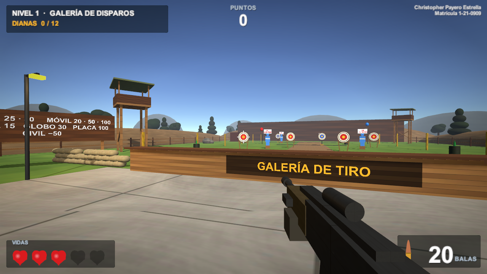
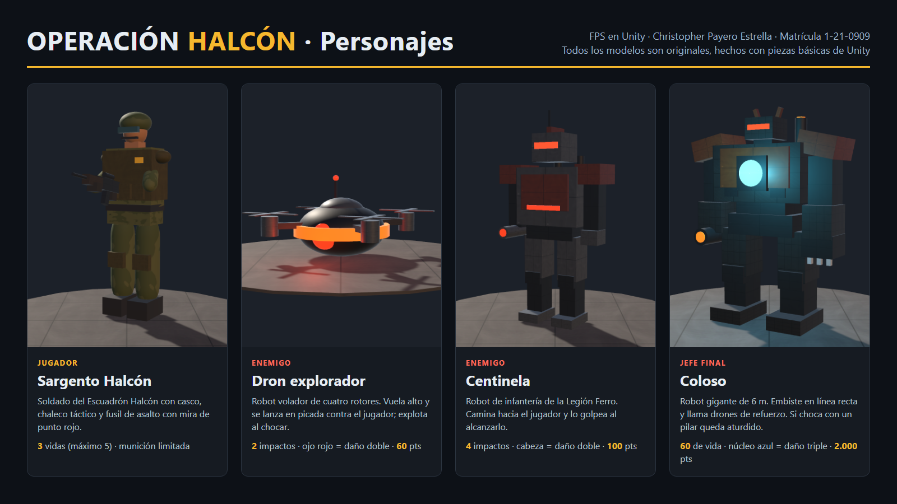

# Operación Halcón

Videojuego **FPS** (disparos en primera persona) hecho en **Unity 6** para la asignatura **Programación de Videojuegos**.

**Alumno:** Christopher Payero Estrella · **Matrícula:** 1-21-0909

**Jugar en línea:** https://christ2723.github.io/OperacionHalcon/

## Historia

El Sargento Halcón, del Escuadrón Halcón, entrena en la galería de tiro cuando la **Legión Ferro**, un ejército de robots,
toma la base militar. Tiene que limpiar la base oleada por oleada y entrar en la guarida del **Coloso**, el robot gigante que los dirige.

## Niveles

| Escena | Misión |
|---|---|
| `00 Menu` | Menú de entrada: Jugar, Cómo jugar, Personajes, Salir |
| `01 Galeria de disparos` | Destruir 12 objetivos con 20 balas; cada objetivo y cada anillo dan puntos distintos |
| `02 Base enemiga` | Eliminar 3 oleadas de robots (centinelas y drones) |
| `03 Guarida del Coloso` | Derrotar al jefe final |
| `04 Fin` | Victoria o derrota con puntuación, vidas restantes y **Volver a jugar** |

## Controles

| Acción | Tecla |
|---|---|
| Moverse | Flechas (o WASD) |
| Apuntar | Ratón |
| Disparar | Clic izquierdo |
| Saltar | Espacio |
| Correr | Shift |
| Pausa | Esc o P |

## Puntuación

| Objetivo | Puntos |
|---|---|
| Diana (borde · anillo · centro) | 10 · 25 · 50 |
| Diana móvil | 20 · 50 · 100 |
| Botella / Globo / Placa lejana | 15 / 30 / 100 |
| Civil (silueta azul) | **−50** |
| Dron / Centinela / Antena | 60 / 100 / 150 |
| Coloso | 2.000 |

Cabeza del centinela y ojo del dron: daño x2. Núcleo del Coloso: daño x3 (x6 si está aturdido tras chocar con un pilar).

La partida termina al quedarse **sin munición** o **sin vidas** (un enemigo que te toca te quita una vida).

## Personajes

## Cómo está hecho

Todo el contenido (modelos, texturas, sonidos, música, prefabs y escenas) lo genera el script de editor
`Assets/Editor/ConstructorProyecto.cs` (menú **Halcon › Construir todo**). La explicación completa está en
[`Explicacion.txt`](Explicacion.txt).

`Assets/Editor/PruebaAutomatica.cs` (menú **Halcon › Prueba automática**) juega la partida completa y verifica 48 puntos.

## Abrir el proyecto

1. Abrir la carpeta con Unity **6000.6.4f1**.
2. Abrir `Assets/Scenes/00 Menu.unity` y pulsar Play.
3. Para regenerar todo: **Halcon › Construir todo**. Para compilar para navegador: **Halcon › Compilar WebGL**.
